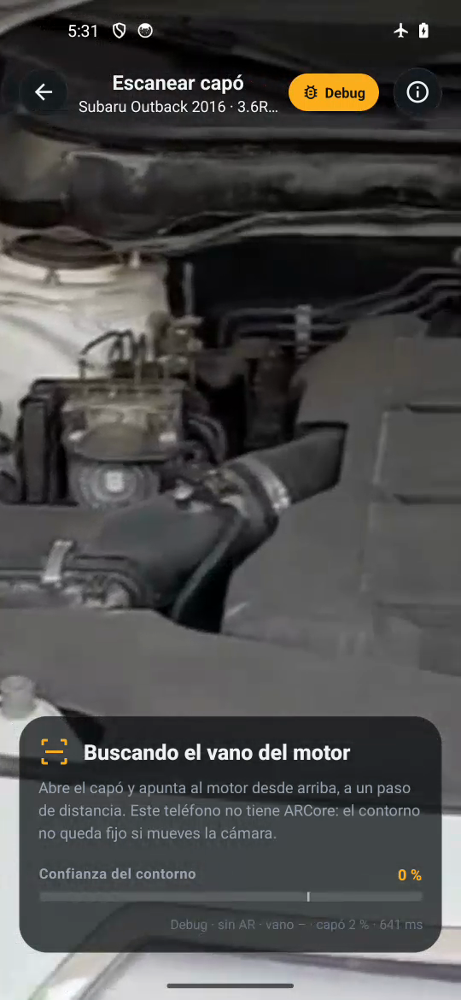
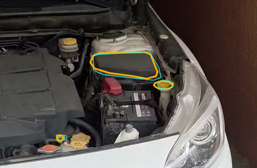
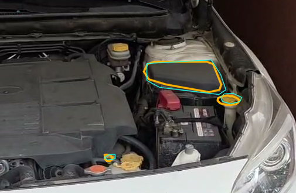

# Subaru Outback 2016 3.6R registration evidence

The Android scanner and the offline registration experiment used the same engine video. Only the first image is an Android screen capture.

Trial APK build 32 (edadb93), with the video supplied to the emulator's camera. The scanner showed the fallback for a device without ARCore and displayed 0% contour confidence. Physical ARCore tracking remains untested in this run.

## Offline cold starts

Six manually marked landmarks in the first frame established a reference pose. The reference excluded the three evaluated parts from feature matching. Each of the next 39 sampled frames was processed independently against that reference. Both ORB and SIFT with PnP returned a pose in 39/39 frames. For each method, all nine evaluated centers fell inside the manually traced outline (five dipstick observations, two washer cap and two fuse box). These results cover one recording and use estimated camera intrinsics.

Yellow outlines project the model's upper surfaces using the ORB pose. Cyan outlines trace the visible parts by hand. The fuse box is above the battery, the washer cap is to its right, and the dipstick handle is near the bottom of each crop.

At 5 seconds the fuse box center is inside its outline, while the projected lower edge differs visibly from the manual trace.

At 6 seconds the three parts have shifted right in the frame. This pose was computed without the preceding frame.

The [per-frame measurements](measurements.csv) report center errors in pixels of the original 576 × 1248 video. Rows repeat frame timing when several parts were annotated. Empty error fields indicate an unannotated frame. Processing times are local Mac measurements and exclude image decoding.
