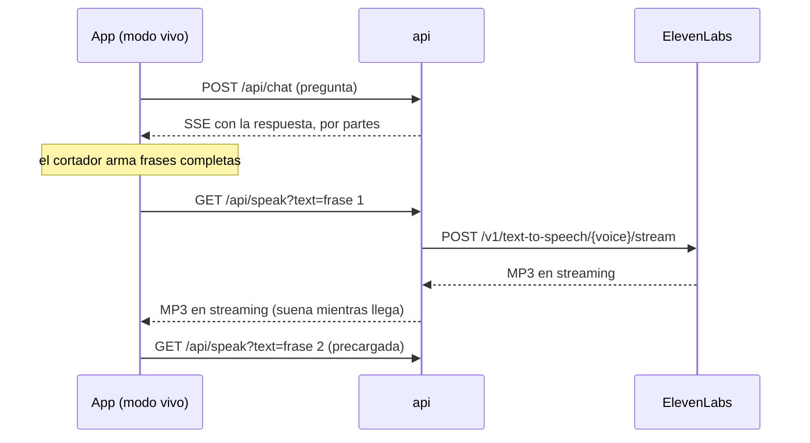

# Voz del asistente — leer las respuestas en voz alta con ElevenLabs

El asistente lee en voz alta lo que muestra la tarjeta del modo vivo, con una voz de ElevenLabs. Primero en el modo vivo, donde tienes las manos en el motor; después en el chat.

Cambia lo que decía el ítem I de `docs/plan.md` («El servidor no cambia»): la key de ElevenLabs vive en el servidor, así que el audio pasa por el `api`.

## Decisiones

| Tema | Decisión | Por qué |
|---|---|---|
| Dónde habla primero | Modo vivo; el chat en la fase 2 | Es donde no puedes mirar la pantalla |
| Interrumpir | Tocar la tarjeta. Mientras habla, el micrófono no escucha | Sin cancelación de eco, el asistente se transcribiría a sí mismo y se cortaría solo |
| Voz | Una voz de la Voice Library en español latino, con su `voice_id` fijo en el servidor | Las voces por defecto de ElevenLabs expiran el 31-12-2026. La Voice Library no se puede usar por API en el plan Free |
| Cuándo empieza | Por frase, mientras llega la respuesta | Empieza ~1 s después de la primera frase, sin esperar la respuesta completa |
| Modelo | `eleven_flash_v2_5` | El de tiempo real con español: ~100 ms de mediana y US$0,04 por 1.000 caracteres |

## Arquitectura

- **Patrón:** proxy de streaming en el servidor, igual que `/api/transcribe` (`api/src/transcribe/handler.ts`): la key nunca sale del servidor.
- `GET /api/speak?text=<frase>` llama a `POST /v1/text-to-speech/{voice_id}/stream` de ElevenLabs y devuelve el MP3 a medida que llega.
- La app reproduce cada frase con `createAudioPlayer({ uri, headers })` de `expo-audio`, que empieza a sonar antes de terminar la descarga. Es GET porque el reproductor solo hace GET.
- **Descartado:** el WebSocket `stream-input` directo desde la app. Tendría la menor latencia, pero devuelve trozos de MP3 en base64 y `expo-audio` no tiene cómo reproducir audio por trozos sin código nativo.

## Fases

| Fase | Done cuando | Tamaño |
|---|---|---|
| [1](fase-1.md) | En el modo vivo escuchas la respuesta mientras aparece en la tarjeta; tocarla la calla | ~400 líneas |
| [2](fase-2.md) | El chat también habla: ajustes para encender o apagar la voz en el chat y en el modo vivo, y botón por mensaje para escuchar o callar. Reusa `/api/speak`, el cortador y la cola | ~300 líneas |
| 3 | Bordes: la tarjeta avanza al ritmo del audio, aviso visible si se acaba la cuota (sigue con subtítulos), caché en el servidor de las frases que se repiten (instrucciones de pasos) | ~300 líneas |

Después, si hace falta: interrumpir hablando encima (necesita cancelación de eco) y elegir la voz desde la app.

## Pendiente antes de cerrar la fase 1

- El `voice_id` de la voz elegida en la Voice Library. Mientras, la fase avanza con una voz provisoria.
- Confirmar que la key de ElevenLabs tiene permiso de Text to Speech: `curl "https://ph26.berguecio.cl/api/speak?text=hola"` tiene que sonar.
